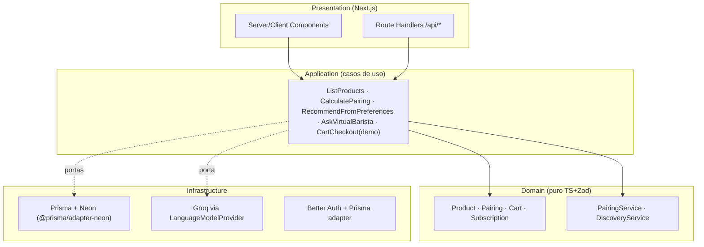

# Arquitetura — Café Bourbon

## Dependências
- `domain/` importa só `zod` (esquemas de invariantes) — nada de Next/React/Prisma/Groq.
- `application/` depende de portas (`ProductRepository`, `LanguageModelProvider`), nunca de `PrismaClient` direto.
- `infrastructure/database/prisma.ts`: singleton + `PrismaNeon`; `infrastructure/ai/groq-provider.ts`: único arquivo que importa `groq-sdk`.
- Rotas: `parse Zod → chama caso de uso → serializa`. Erros de domínio viram 4xx com mensagem segura; erros de infra viram 500 genérico + log sem segredo.

## Auth (Better Auth)
Email/senha + OAuth opcional. Tabelas `User, Session, Account, Verification` no mesmo schema Prisma. Rotas `/api/auth/[...all]` via `toNextJsHandler`. Sessão verificada no servidor; cliente recebe só `user` seguro.

## UI (shadcn BaseUI)
Tudo em `@/components/ui`. Páginas usam `Card, Badge, Button, Skeleton, Sonner, Tabs, Accordion, Form, Select, Slider`. Tema café (espresso/creme/bordô) via `@theme` no CSS, sem CSS global ad-hoc.

## Env (validado com Zod em `src/lib/env.ts`)
`DATABASE_URL` (pooled), `DATABASE_URL_UNPOOLED` (migrations), `BETTER_AUTH_SECRET`, `BETTER_AUTH_URL`, `GROQ_API_KEY` (opcional — sem ela o assistente usa fallback), `NEXT_PUBLIC_APP_URL`.
