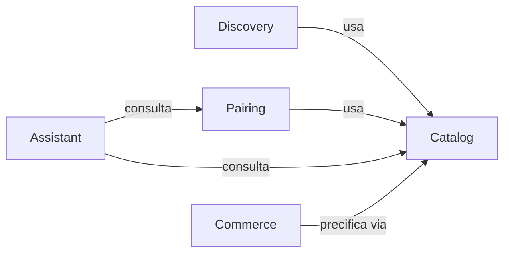

# Modelo de domínio — Café Bourbon

## Contextos delimitados
`catalog` · `pairing` · `discovery` · `assistant` · `commerce`

## Catalog
- **Entidade** `Product` (raiz): `id: ProductId`, `name`, `slug` (único), `description`, `type: ProductType (COFFEE|CHEESE|WINE)`, `price: Money | null`, `imageUrl | null`, `available: boolean`, `isDemoData: boolean`, + 1 perfil específico.
- **VOs**: `ProductId` (cuid, não vazio), `Money` (centavos inteiros ≥ 0 + `currency: 'BRL'`; soma só mesma moeda), `SensoryNote` (string normalizada 2–40 chars).
- **Perfis** (1:1 com Product): `CoffeeProfile { origin, variety?, process?, roastLevel 1–5, intensity 1–5, acidity 1–5, body 1–5, notes: SensoryNote[], brewMethods: BrewMethod[] }`, `CheeseProfile { milkType, style, agingDays?, texture, intensity 1–5, acidity? 1–5, notes[] }`, `WineProfile { grapes[], region?, style, vintage?, body 1–5, acidity 1–5, tannins 1–5?, notes[], alcoholPct? }`.
- **Eixos sensoriais** (`Product.sensory`): queijo usa `intensity` como proxy de `body`; vinho usa `body` como `intensity`; `acidity` pode ser `null` (critério de acidez considera neutro = 7/15).
- **Invariantes**: slug único; preço ausente ⇒ produto não comprável; vinho sem `alcoholPct` não exibe teor; `isDemoData=true` para queijos/vinhos até verificação comercial.

## Pairing
- **Entidade** `Pairing`: `id`, `productIds` (2–3, tipos distintos), `origin: EDITORIAL|CALCULATED`, `score: PairingScore (0–100)`, `criteria: PairingCriterion[]`, `explanation: string`, `published: boolean`.
- Score editorial é fixo revisado; calculado vem de `PairingService` (ver `docs/pairing-rules.md`). Nunca apresentar score como verdade científica — é heurística do sistema.

## Discovery
- `TasteProfile { intensity 1–5, acidity 1–5, body 1–5, preferredNotes[], categories[], maxPriceCents?, brewMethod?, wineStyle?, cheeseStyle? }` (Zod na borda). `DiscoveryService.score(product, profile)` determinístico; sem resultados ⇒ retorna fallback editorial + motivo.

## Assistant
- `AskVirtualBarista { message, history? }` → consulta Catalog/Pairing por casos de uso controlados, monta contexto mínimo para o LLM, valida saída (produtos citados precisam existir no banco). LLM nunca decide preço/disponibilidade.

## Commerce (carrinho + assinatura)
- `Cart { items: CartItem[] }` — `CartItem { productId, quantity 1–99 }`; total calculado no servidor a partir do preço do banco.
- `Subscription { plan: MENSAL|COFFEE_LOVERS|TRIMESTRAL, grind: GRAOS|MOIDO, brewMethod?, coffeeId }` — preços: 9000 / 12000 / 27000 centavos. Sem checkout/pagamento real nesta versão.
